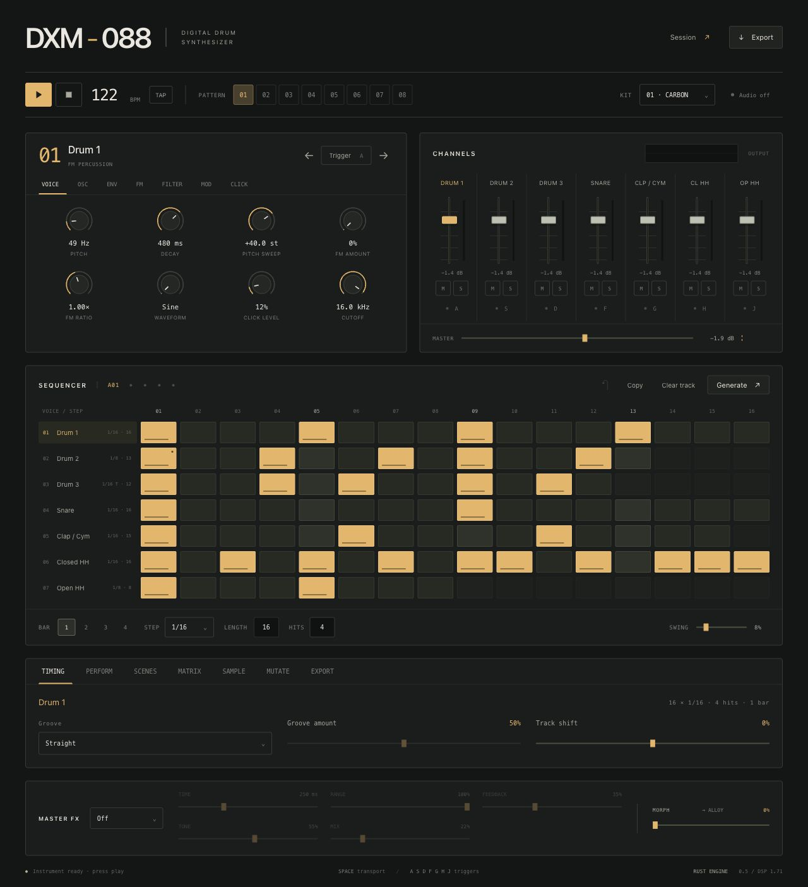

# DXM-088

A digital drum synthesizer with a Rust audio engine, a polyrhythmic sequencer and
a shared browser / plug-in editor.

**macOS:** VST3, Audio Unit v2 and CLAP · **Windows x64:** VST3 and CLAP.

[Download releases](https://github.com/fushugaku/DXM-088/releases)
· [Plug-in manual](plugin/README.md)
· [Attribution](NOTICE.md)



## Instrument

- Six synth voices and seven tracks, with closed/open hi-hat choke.
- FM, waveform oscillators, filters, transient generators, drive and master FX.
- 128 patterns in sixteen banks A–P; each track has its own step division, 1–64 step length and hit count.
- Straight, triplet and dotted divisions; microtiming, groove, swing and ratchets.
- Per-step probability, eight trigger conditions, Fill and two parameter locks.
- A sound/mix scene for every pattern, four macros, a 16-route modulation matrix and two tempo LFOs.
- MIDI velocity, aftertouch and mod wheel; optional WAV layers on every track.
- Euclidean generation, protected sound mutation, undo and project autosave.
- WAV, MIDI and seven-stem ZIP export. macOS also supports native export drag into a DAW.
- 283 host automation parameters and a local WebView editor with no server dependency.

Every MIDI note **0–127 (C−2–G8)** selects its own pattern and plays while held.
New projects map **0 → A01**, **7 → A08**, **8 → B01**, **127 → P08**.
The last held note wins; releasing it returns to the previous held note.
Releasing all notes stops the sequencer. Pattern changes can be immediate,
on the next 1/16, or on the next 4/4 bar. The sequencer follows the host tempo,
PPQ, seeking and loops. Octave names vary by DAW; MIDI numbers are unambiguous.
The bank selector shows eight slots at a time and follows incoming MIDI notes.
The **A01** field rotates the mapping while keeping all 128 notes available.

DXM-088 is the new name of the earlier local LXR02 Rust instrument. Existing
format IDs, parameter IDs and project data remain compatible. Avoid installing
both names of the same plug-in format together: they identify the same instrument.
Projects use JSON v4 and can import earlier v1/v2/v3 files, including `.lxr02.json`.
Older projects keep their original MIDI origin (usually 24), eight patterns and
scenes; the added slots receive independent copies of those eight templates.
The demo is [Polyrhythm Scenes](examples/Polyrhythm%20Scenes.dxm088.json).

## Install

Download a platform archive from [Releases](https://github.com/fushugaku/DXM-088/releases).

**macOS 11+, Intel and Apple Silicon:** open the `.pkg` and choose VST3 / AU / CLAP.
It installs for the current user in `~/Library/Audio/Plug-Ins/`.
The bundles use ad-hoc signing; the installer has no Developer ID notarization.

**Windows 10/11 x64:** extract the ZIP and run `Install.cmd`. It copies VST3 and
CLAP into the current user's standard plug-in directories, without admin rights.
Keep `DXM-088.resources` beside `DXM-088.clap` when installing manually.
The VST3 bundle contains its editor resources. Install the
[Microsoft WebView2 Runtime](https://developer.microsoft.com/en-us/microsoft-edge/webview2/)
if it is missing, then rescan plug-ins in your DAW.
AU is available on macOS only. Windows ARM64, 32-bit Windows and Linux plug-in
adapters are not provided. A successful build does not establish compatibility
with every DAW.

## Build

Dependencies: Rust stable, Python 3, Node.js/npm and CMake 3.22+. Native plug-ins
also require Xcode command line tools on macOS, or Visual Studio 2022 C++ Build
Tools with the Windows SDK on Windows. SDK revisions are pinned in
[`plugin/SOURCES.json`](plugin/SOURCES.json).

Browser instrument:

```sh
rustup target add wasm32-unknown-unknown
./run.sh
# Open http://127.0.0.1:8732
```

macOS universal plug-ins and installer:

```sh
./tools/build-plugins.sh
```

Windows x64, from PowerShell:

```powershell
./tools/build-plugins.ps1
```

Outputs go to `build/plugins/`. The Windows Actions workflow builds on a Windows
runner, checks the Rust engine and legacy project migration, loads the compiled
CLAP module and packages offline editor resources and dependency licenses.
Pushing a `v*` tag publishes the Windows ZIP and SHA-256 file to a GitHub release.

```sh
cargo test --locked
cargo test --locked --manifest-path plugin/engine/Cargo.toml
node tools/verify-project-format.mjs
node tools/verify-pattern-bank.mjs
# After building WASM:
node tools/verify-performance.mjs
```

The Rust crates, exported C/WASM function names and some source filenames retain
`lxr02` internally for compatibility. The command-line executable is `dxm088`:

```sh
target/release/dxm088 render demo.wav --bars 4 --bpm 128 --kit 0
```

## DSP provenance

The synthesis core was translated from LXR-02 firmware 1.71: phase-modulation
oscillators, envelopes, SVF/LP2 filters, original transient and waveform tables,
drive, tube/fold/clip, compressor, ring modulation and delay. Firmware-derived
fixtures record ARM reference outputs for the DSP tests. The complete firmware,
local decompilation workspace, private DAW projects and local QA artifacts are
excluded from this repository.

DXM-088 is an independent project and is not affiliated with Erica Synths or
Sonic Potions. Original firmware and ROM rights remain with their owners.
See [NOTICE.md](NOTICE.md) for provenance and third-party component notices.
